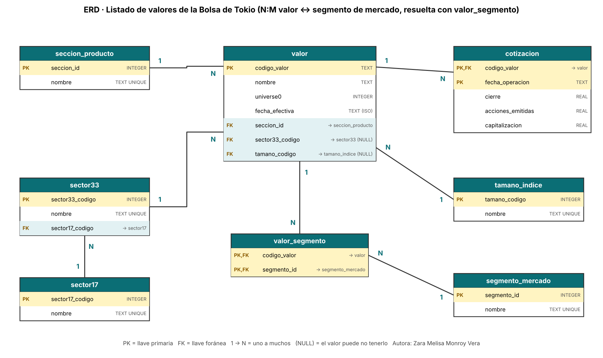

# Semana 6 · ERD de mi caso: listado de valores de la Bolsa de Tokio

```python
FULL_NAME   = "Zara Melisa Monroy Vera"
GITHUB_USER = "zara-mon2006"
```

Asignatura: Ciencia de Datos · Ingeniería Industrial · Corporación Universitaria del Huila (CORHUILA) · 2026-B · Corte 2.
Guía de la actividad: *Semana 6 · ERD de tu caso* (formativa, opcional).

## 1. Caso y datos

El caso es el **catálogo de valores listados en la Bolsa de Tokio (JPX)** (`stock_list.csv`). Cada fila es un valor (acción, ETF, REIT…) con su código, nombre, clasificación de mercado, sector (17 y 33 grupos), serie de tamaño del índice TOPIX y, cuando existe, una cotización de cierre con acciones emitidas y capitalización.

Son **4 417 valores**, con fechas efectivas entre 2000-01-01 y 2022-02-25. **4 121** tienen cotización (cierres entre 2021-12-16 y 2021-12-30). Los 296 restantes no tienen precio. Los datos de partida los limpia la semana 9 (`../09-week/limpieza.py`); aquí se usa el resultado, `data/stock_list_clean.csv`.

## 2. ERD



La versión en Mermaid está en [`erd.md`](erd.md) y el DDL en [`schema.sql`](schema.sql).

| Entidad | PK | FK | Qué guarda |
|---|---|---|---|
| `valor` | `codigo_valor` | `seccion_id`, `sector33_codigo` (NULL), `tamano_codigo` (NULL) | El valor listado, una fila por código |
| `cotizacion` | (`codigo_valor`, `fecha_operacion`) | `codigo_valor` | Cierre, acciones emitidas y capitalización |
| `sector17` | `sector17_codigo` | – | Catálogo de 17 sectores |
| `sector33` | `sector33_codigo` | `sector17_codigo` | Catálogo de 33 sectores; cada uno pertenece a un solo sector de 17 |
| `tamano_indice` | `tamano_codigo` | – | Core30, Large70, Mid400, Small 1, Small 2 |
| `seccion_producto` | `seccion_id` | – | Clasificación antigua (First Section, ETFs…) |
| `segmento_mercado` | `segmento_id` | – | Prime, Standard, Growth y variantes de acciones extranjeras |
| `valor_segmento` | (`codigo_valor`, `segmento_id`) | ambas | **Tabla intermedia N:M** valor ↔ segmento |

### Relaciones

- `sector17` 1:N `sector33` 1:N `valor`: la jerarquía sectorial. El sector es opcional (ETF y fondos no lo tienen).
- `seccion_producto` 1:N `valor`, `tamano_indice` 1:N `valor` (opcional).
- `valor` 1:N `cotizacion`: un valor puede tener una cotización por fecha de operación.
- `valor` N:M `segmento_mercado`, resuelta con `valor_segmento`.

> **Aclaración honesta sobre el N:M:** en el archivo actual cada valor tiene **como máximo un** segmento, así que `valor_segmento` hoy se comporta como 1:N (3 772 filas, ninguna repetida por valor). Lo dejé como N:M porque el segmento es una clasificación que JPX reasigna en el tiempo y el modelo no debería romperse si se cargan varias fechas. Del mismo modo, `cotizacion` hoy tiene una sola fecha por valor, pero su llave ya admite historia.

## 3. ¿Relacional o NoSQL?

**Elegí el enfoque relacional (SQL).**

1. **Datos tabulares y de esquema fijo:** las 16 columnas son las mismas para todos los valores.
2. **Jerarquías y catálogos:** el sector de 33 grupos depende del de 17; modelarlo con llaves foráneas evita incoherencias (Elmasri y Navathe, 2016).
3. **Integridad:** no puede haber una cotización de un código inexistente ni un sector fuera del catálogo.
4. **Consultas típicas** (capitalización por sector, valores por segmento) son `JOIN` + `GROUP BY`, el caso natural de SQL (Codd, 1970).
5. **Volumen pequeño** (4 417 filas): no hay un problema de escala que justifique NoSQL.

**Cuándo cambiaría:** si se guardara el flujo de cotizaciones intradía de todos los valores, esa serie temporal encajaría mejor en un almacén de series de tiempo o columnar (MongoDB, s. f.), dejando el catálogo en SQL.

## 4. Normalización

El CSV es una tabla plana: el nombre del sector se repite en cada valor del sector, y el de 17 grupos se repite a su vez junto al de 33.

| Forma normal | Qué apliqué | Redundancia evitada |
|---|---|---|
| **1FN** | Una celda, un valor; los faltantes son NULL reales (no «-»). | Marcadores mezclados de faltante. |
| **2FN** | Los datos de precio dependen de (código, fecha), no solo del código: van en `cotizacion`. | Mezclar atributos del valor con los de su cotización. |
| **3FN** | Nombre de sector, de tamaño, de sección y de segmento dependen del código del catálogo, no del valor; el sector de 17 depende del de 33 (dependencia transitiva): va en `sector33.sector17_codigo`. Lo verifiqué en los datos (cada código tiene un nombre y cada sector de 33 un solo sector de 17). | Nombres de sector repetidos miles de veces. |

La llave de `valor` es el **código**, no el nombre: hay 5 nombres repetidos que corresponden a empresas distintas.

## 5. Cómo reproducirlo

```bash
python build_db.py        # crea stock.db y verifica las llaves foráneas
python dibujar_erd.py     # regenera erd.png
```

Resultado de la carga: `sector17` 17 · `sector33` 33 · `tamano_indice` 5 · `seccion_producto` 11 · `segmento_mercado` 6 · `valor` 4 417 · `cotizacion` 4 121 · `valor_segmento` 3 772, con **0 violaciones de llave foránea**.

## 6. Limitaciones

- La fecha `2000-01-01` aparece en 286 valores, todos sin precio; parece un valor por defecto y no una fecha real. No la traté como error ni la corregí.
- No se documenta qué significa `Universe0` (2 000 valores lo tienen en verdadero); lo guardé tal cual.
- La moneda no viene declarada; se asume yenes.
- Los 8 209 faltantes se conservan como NULL: no imputé precios ni acciones.
- Los ETF y fondos están en la misma tabla `valor`; para análisis de capitalización conviene filtrarlos por `seccion_producto`.

## 7. Referencias

Chen, P. P. (1976). The entity-relationship model—Toward a unified view of data. *ACM Transactions on Database Systems, 1*(1), 9–36.

CORHUILA. (2026). *Ciencia de Datos · Semana 6 · Modelamiento de datos* [Material de clase]. Corporación Universitaria del Huila. https://code-corhuila.github.io/ova-web/2026-B/ciencia-datos/06-week/01-session/

Codd, E. F. (1970). A relational model of data for large shared data banks. *Communications of the ACM, 13*(6), 377–387.

Date, C. J. (2019). *Database design and relational theory: Normal forms and all that jazz* (2.ª ed.). Apress.

Elmasri, R., y Navathe, S. B. (2016). *Fundamentals of database systems* (7.ª ed.). Pearson.

Japan Exchange Group. (s. f.). *Listed company search / Securities list* [Sitio web]. https://www.jpx.co.jp/english/

Mermaid. (s. f.). *Entity relationship diagrams*. https://mermaid.js.org/syntax/entityRelationshipDiagram.html

MongoDB. (s. f.). *Data modeling*. https://www.mongodb.com/docs/manual/data-modeling/

SQLite. (s. f.). *SQLite foreign key support*. https://www.sqlite.org/foreignkeys.html
