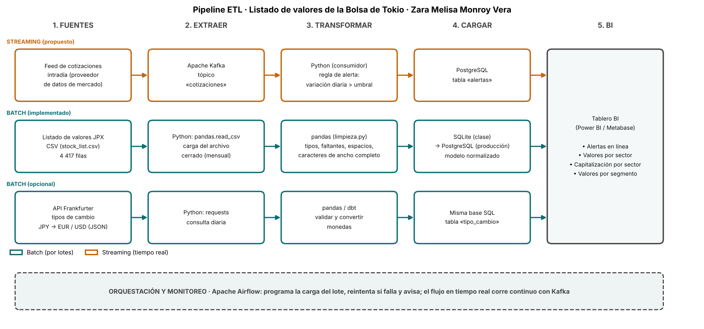

# Semana 8 · Pipeline ETL del listado de valores de la Bolsa de Tokio

## ESTUDIANTES: ZARA MELISA MONROY VERA E IVÁN DAVID CARDOZO CHARRY

Asignatura: Ciencia de Datos · Ingeniería Industrial · CORHUILA · 2026-B · Corte 2.
Guía de la actividad: *Semana 8 · Conexión de datos: APIs, ETL y pipelines* (formativa, opcional).

## Qué se entrega

| Archivo | Contenido |
|---|---|
| [`pipeline_etl.png`](pipeline_etl.png) | Diagrama del pipeline con la herramienta de cada paso |
| [`pipeline.mmd`](pipeline.mmd) | El mismo diagrama en Mermaid (editable) |
| [`consumir_api.py`](consumir_api.py) | Consumo de una API pública con `requests`; muestra 3 registros (parte opcional) |
| [`api_sample.json`](api_sample.json) | Muestra guardada de la respuesta de la API, usada como respaldo |
| [`dibujar_pipeline.py`](dibujar_pipeline.py) | Genera la imagen del diagrama |

## 1. Pipeline: fuentes → extraer → transformar → cargar → BI



| Paso | Batch (por lotes) | Streaming (tiempo real) |
|---|---|---|
| **Fuentes** | CSV del listado de valores JPX; API Frankfurter (tipos de cambio) | Feed de cotizaciones intradía |
| **Extraer** | `pandas.read_csv`; `requests` | Apache Kafka, tópico `cotizaciones` |
| **Transformar** | `pandas`: tipos, faltantes, espacios y caracteres de ancho completo ([`limpieza.py`](../09-week/limpieza.py)); `pandas`/`dbt` para convertir monedas | Consumidor en Python con una regla de alerta |
| **Cargar** | SQLite en clase → PostgreSQL en producción, con el modelo de la [semana 6](../06-week/README.md) | Tabla `alertas` en PostgreSQL |
| **BI** | Power BI o Metabase: valores y capitalización por sector, valores por segmento | Panel de alertas |
| **Orquestación** | Apache Airflow programa la carga, reintenta y avisa si falla | Kafka corre de forma continua |

**Qué está implementado y qué es diseño.** El flujo por lotes del CSV sí existe y funciona (semanas 6, 7 y 9, integradas en la [semana 10](../10-week/README.md)). El streaming es una **propuesta**: el archivo es una foto con cierres de 2021 y no hay un feed de cotizaciones conectado. El diagrama lo marca como «propuesto» frente a «implementado».

## 2. Batch vs. streaming: justificación

| Parte | Elección | Por qué |
|---|---|---|
| **Listado de valores** | Batch | Es un archivo cerrado que cambia cuando JPX lo actualiza (altas, bajas, reclasificaciones); las preguntas (valores por sector, capitalización por segmento) se responden bien con una carga periódica. |
| **Limpieza** | Batch | Validaciones como «cada código tiene un solo nombre de sector» o «el código es único» necesitan ver el lote completo. |
| **Tipos de cambio** | Batch | El BCE publica una tasa por día hábil, así que una consulta diaria agota la información disponible. |
| **Alertas de precio** | Streaming (propuesto) | Un movimiento brusco de precio pierde valor si se detecta al día siguiente. |

**Por qué no pasar todo a streaming:** añade Kafka, más piezas que operar y más puntos de falla, sin beneficio para un catálogo que se actualiza por lotes. El streaming queda reservado para lo único que pierde valor con el retraso.

**Límite del diseño:** la regla de alerta («variación diaria > umbral») no tiene un umbral definido porque el archivo tiene una sola fecha de cierre por valor y no permite calibrarlo. Es parte del diseño, no un resultado.

## 3. Consumo de una API (parte opcional)

`consumir_api.py` consulta la API pública **Frankfurter** (tasas del Banco Central Europeo, sin llave) y pide JPY → EUR y USD del 28 al 30 de diciembre de 2021, los últimos días de cotización del dataset:

```bash
python consumir_api.py
```

Salida (3 registros, uno por fecha):

| fecha | base | EUR | USD |
|---|---|---:|---:|
| 2021-12-28 | JPY | 0.00768 | 0.00871 |
| 2021-12-29 | JPY | 0.00769 | 0.00870 |
| 2021-12-30 | JPY | 0.00767 | 0.00869 |

El script sigue el ciclo de ETL en miniatura: `extraer()` hace la petición con `requests`, `transformar()` convierte el JSON anidado a tabla y el resultado se guarda en `muestra_api_3_registros.csv`.

**Cómo se probó (para que no haya malentendidos):**

- Esos valores vienen de una consulta real a la API, hecha con una herramienta de lectura web, y se guardaron en `api_sample.json`.
- Desde el entorno donde ejecuté el script **no había salida a internet** (error de proxy), así que lo que corrió fue la ruta de **respaldo**, y el script lo avisa. La ruta «en vivo» (`requests.get`) está escrita pero **no la pude ejecutar aquí**; conviene correrla una vez con conexión.
- Los tipos de cambio son de diciembre de 2021, no actuales; la API puede devolver otras fechas si cambias el rango.

## 4. Referencias

CORHUILA. (2026). *Ciencia de Datos · Semana 8 · Conexión de datos: APIs, ETL y pipelines* [Material de clase]. Corporación Universitaria del Huila. https://code-corhuila.github.io/ova-web/2026-B/ciencia-datos/08-week/01-session/

Frankfurter. (s. f.). *Frankfurter: Currency data API*. https://frankfurter.dev/

Kimball, R., y Ross, M. (2013). *The data warehouse toolkit: The definitive guide to dimensional modeling* (3.ª ed.). Wiley.

Kleppmann, M. (2017). *Designing data-intensive applications*. O'Reilly Media.

Mermaid. (s. f.). *Flowchart syntax*. https://mermaid.js.org/syntax/flowchart.html

Reitz, K. (s. f.). *Requests: HTTP for humans* [Documentación]. https://requests.readthedocs.io/en/latest/

The Apache Software Foundation. (s. f.). *Apache Airflow documentation*. https://airflow.apache.org/docs/

The Apache Software Foundation. (s. f.). *Apache Kafka documentation*. https://kafka.apache.org/documentation/
