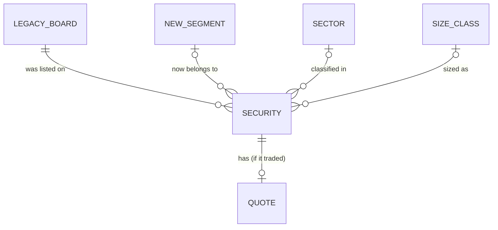

# Week 9 — Version 2: Market reform & size classes (Corte 2)

Same dataset as version 1 (`stock_list.csv`, Tokyo Stock Exchange), but a different focus: **how the market structure was reorganised** (old sections → new Prime/Standard/Growth segments) and **who leads each TOPIX size class**.

## Contents

| Path | What it is |
|---|---|
| `cleaning_and_queries_v2.ipynb` | Executed notebook: diagnosis → cleaning → before/after → SQLite → 2 queries |
| `docs/erd.md` | ERD (Mermaid) with attributes and cardinalities |
| `sql/schema.sql` | DDL for the ERD |
| `data/raw/stock_list.csv` | Original file |
| `data/clean/stock_list_clean_v2.csv` | Cleaned dataset (all 4,417 rows kept, 25 columns incl. quality flags) |
| `data/clean/before_after_report_v2.csv`, `null_classification_v2.csv` | Before/after metrics and null classification |
| `data/clean/tse_market_v2.db` | SQLite database |
| `docs/q1_migration.png`, `docs/q2_class_leaders.png` | Charts |

## ERD

Centred on the market reform; optional foreign keys keep real missing data as `NULL`. Full diagram: [`docs/erd.md`](docs/erd.md).



## Before / after cleaning

| Metric | Before | After |
|---|---:|---:|
| Rows | 4,417 | 4,417 (nothing deleted) |
| Columns | 16 | 25 (derived + 4 quality flags, 2 redundant dropped) |
| Null / disguised-null cells (NaN, `-`, sentinel) | 8,495 | 2,235 (all real missing, flagged) |
| `-` disguised nulls | 6,380 | 0 |
| Sentinel dates (`20000101`) | 286 | 0 (set to NULL + flag) |
| Date columns as real dates | 0 | 2 |
| Distinct `17SectorName` labels | 34 | 18 |
| Instrument type identifiable | no | Equity / ETF-ETN / REIT-Fund |

## Data & cleaning

The dataset is the Tokyo Stock Exchange list of 4,417 listed securities as of December 30, 2021, containing companies, ETFs and REITs together with their old board, new market segment, sector, TOPIX size class, closing price, shares issued and market capitalization. Instead of simply deleting incomplete rows, I classified every missing value as either structural (the field does not apply, for example a sector for an ETF) or genuinely missing (an equity without a price or segment), imputing the first kind with explicit labels and keeping the second kind as NULL with quality flags. I also found that 286 rows carry the placeholder date 2000-01-01, which is not a real listing date, so I replaced it with a missing value and a flag, converted all dates and numbers to proper types, replaced the 6,380 "-" placeholders with real nulls, and fixed trailing spaces that had split 17 sectors into 34 labels. I derived new columns for instrument type, legacy board group, foreign listing, legal form and size rank, dropped two redundant columns, and found no exact duplicates (seven repeated names belong to different companies, so they were kept). The first question asked where each old board landed after the reform: 78.9% of the 2,331 old First Section equities became Prime, 14.5% became Standard, and 6.5% have no new segment, while Mothers moved 96.8% to Growth and both Second Section and JASDAQ Standard went almost entirely to Standard. The second question asked who leads each TOPIX size class: Toyota is the largest company in Core30 with 14.0% of the class market cap, while the top company weighs only 4.0% in Large70, 1.8% in Mid400, 0.9% in Small 1 and 1.6% in Small 2, so concentration drops sharply as companies get smaller.

## Queries and findings

**Q1 — Where did each legacy board land after the reform?** (filter: equities; aggregation: conditional `COUNT` by old board × new segment, `LEFT JOIN`, cross-checked with `pd.crosstab`.) The old First Section split three ways (Prime 1,840; Standard 339; Growth 1; unassigned 151), whereas the other four boards map almost one-to-one: JASDAQ Standard and Second Section to Standard, Mothers and JASDAQ Growth to Growth. About 300 equities have no new segment and no price; they are likely delisted or merged, but the data alone does not prove it.

**Q2 — Top 3 companies per TOPIX size class and their weight in the class** (filter: priced equities with a size class; aggregation: `ROW_NUMBER() OVER (PARTITION BY ...)` and `SUM() OVER`, cross-checked in pandas.) Toyota (34,351 bn JPY), Sony and Keyence lead Core30; Denso, Oriental Land and SoftBank Corp. lead Large70; Japan Post Bank leads Mid400. The 30 Core30 companies hold 245.3 trillion JPY, more than the 399 Mid400 companies (220.0 trillion).

## How to reproduce

```bash
pip install pandas matplotlib jupyter
jupyter nbconvert --to notebook --execute --inplace cleaning_and_queries_v2.ipynb
```

## Notes

- `FK` columns for segment, sector and size are intentionally nullable; queries use `LEFT JOIN` when those attributes are optional.
- One row has a fractional `IssuedShares` (rounded), so the `close × shares = market_cap` check uses a relative tolerance of 1e-6.
