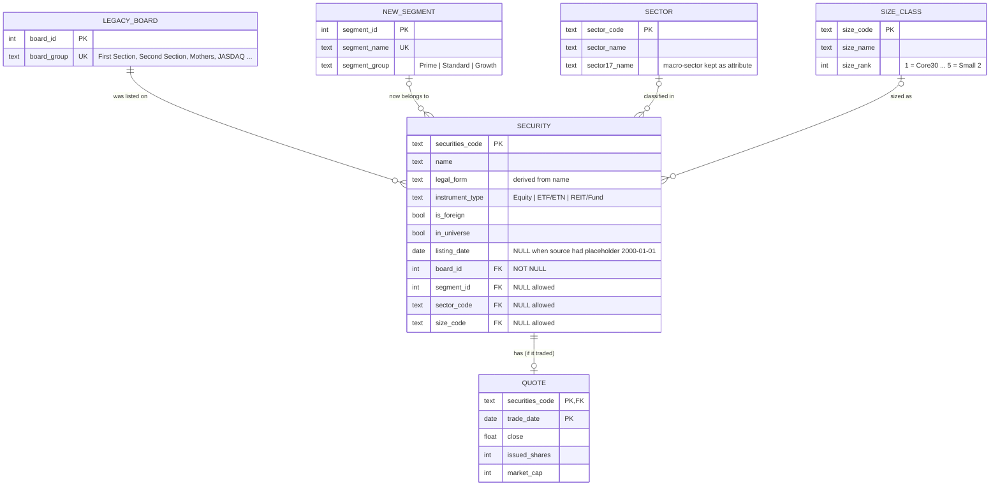

# ERD v2 — Tokyo Stock Exchange: legacy boards → new segments

## Cardinalities

| Relationship | Cardinality | Meaning |
|---|---|---|
| LEGACY_BOARD → SECURITY | 1 : N, mandatory | every security came from exactly one legacy board / product group |
| NEW_SEGMENT → SECURITY | 0..1 : N, **optional** | funds and some equities have no new segment (stored as `NULL`, not as a fake label) |
| SECTOR → SECURITY | 0..1 : N, optional | funds are "not applicable"; some equities are unclassified |
| SIZE_CLASS → SECURITY | 0..1 : N, optional | only TOPIX constituents have a size class |
| SECURITY → QUOTE | 1 : 0..1 per date | a quote exists only if the security traded on the snapshot date (4,121 of 4,417) |

## Design decisions (different from v1)

* The ERD is centred on the **market reform**: the old board (`LEGACY_BOARD`) and the new segment (`NEW_SEGMENT`) are both entities, so the migration can be answered with two joins.
* Foreign keys are **optional** where the source has legitimately missing data; the database keeps `NULL` instead of inventing categories, and queries use `LEFT JOIN`.
* `QUOTE` is separate and only populated when a price exists, so there are no rows full of NULL prices.
* The 17-sector name is kept as an attribute of `SECTOR` (acceptable 2NF trade-off) to keep the model compact.
