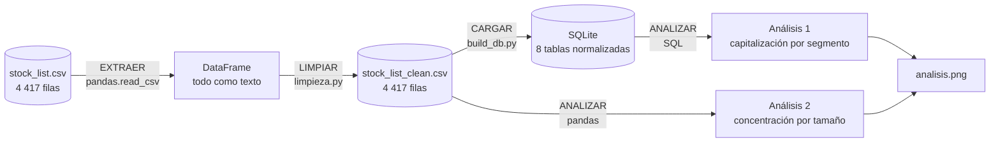

# Semana 10 · Mini-proyecto de datos (cierre del Corte 2)

## ESTUDIANTES: ZARA MELISA MONROY VERA E IVÁN DAVID CARDOZO CHARRY

Asignatura: Ciencia de Datos · Ingeniería Industrial · CORHUILA · 2026-B · Corte 2.
Guía de la actividad: *Semana 10 · Repaso y evaluación del Corte 2* (formativa, opcional).

**Caso:** el catálogo de valores listados en la Bolsa de Tokio (JPX), con cierres de diciembre de 2021. Este mini-proyecto junta, en un solo flujo, lo trabajado en las semanas 6 a 9: modelo de datos, carga y limpieza con pandas y dos análisis con consultas.

> Los análisis son **descriptivos** de este archivo. No son recomendaciones de inversión ni predicciones.

## Qué se entrega

| Archivo | Contenido |
|---|---|
| [`pipeline.py`](pipeline.py) | El flujo completo: extraer → limpiar → cargar → analizar |
| [`data/stock_list.csv`](data/stock_list.csv) | Dataset original (4 417 filas) |
| [`erd.png`](erd.png) | Modelo de datos (ERD); detalle en la [semana 6](../06-week/README.md) |
| `salidas/stock_list_clean.csv` | Datos limpios y listos para analizar |
| `salidas/stock.db` | Los mismos datos en la base SQLite normalizada (8 tablas) |
| `salidas/analisis1_capitalizacion_por_segmento.csv` | Resultado del análisis 1 (SQL) |
| `salidas/analisis2_concentracion_por_serie_tamano.csv` | Resultado del análisis 2 (pandas) |
| `salidas/analisis.png` | Gráfica de ambos análisis |

```bash
python pipeline.py     # necesita 06-week y 09-week al lado: reutiliza su código
```

## 1. Modelo de datos (ERD)


Ocho tablas: `valor`, `cotizacion`, los catálogos `sector17`, `sector33`, `tamano_indice`, `seccion_producto`, `segmento_mercado` y la intermedia N:M `valor_segmento`. La justificación relacional vs. NoSQL y la normalización están en la [semana 6](../06-week/README.md).

## 2. Flujo documentado: extraer → limpiar → analizar



| Etapa | Función | Qué hace | Resultado medido |
|---|---|---|---|
| **Extraer** | `extraer()` | Lee el CSV crudo como texto, sin interpretar nada | 4 417 filas × 16 columnas |
| **Limpiar** | `limpiar_datos()` → `limpiar()` de la semana 9 | Unifica faltantes, quita espacios, normaliza caracteres, convierte tipos y valida | Espacios sobrantes 3 776 → 0 · fechas decimales 4 121 → 0 · faltantes 8 209 → 8 209 (**sin imputar**) |
| **Cargar** | `cargar()` | Guarda el CSV limpio y lo carga en el modelo de la semana 6; verifica llaves foráneas | 4 417 valores · 4 121 cotizaciones · 3 772 pares valor-segmento · **0** violaciones de llave foránea |
| **Analizar** | `analizar()` | Dos consultas (filtro + agregación) y verificación cruzada SQL vs. pandas | Ver sección 3 |

**Datos listos para analizar:** `salidas/stock_list_clean.csv`, con tipos correctos y un solo marcador de faltante. Siguen existiendo faltantes (precios de 296 valores, sectores de 500); no se rellenaron a propósito. Detalle en la [semana 9](../09-week/README.md).

## 3. Dos análisis con consultas

Ambos usan solo **acciones con cotización** (3 776): se excluyen ETF y fondos, que no tienen sector y cuya «capitalización» es el patrimonio del fondo, y los 296 valores sin precio.

### Análisis 1 (SQL): ¿cómo se reparte la capitalización por segmento de mercado?

Filtro: `WHERE v.sector33_codigo IS NOT NULL` (acciones). Agregación: suma y promedio por segmento.

```sql
SELECT g.nombre AS segmento,
       COUNT(*) AS valores_con_cotizacion,
       ROUND(SUM(c.capitalizacion) / 1e12, 2) AS capitalizacion_total_billones_yen,
       ROUND(AVG(c.capitalizacion) / 1e9, 1)  AS capitalizacion_promedio_miles_millones_yen
FROM valor AS v
JOIN cotizacion       AS c  ON c.codigo_valor = v.codigo_valor
JOIN valor_segmento   AS vs ON vs.codigo_valor = v.codigo_valor
JOIN segmento_mercado AS g  ON g.segmento_id = vs.segmento_id
WHERE v.sector33_codigo IS NOT NULL
GROUP BY g.segmento_id, g.nombre
ORDER BY capitalizacion_total_billones_yen DESC, g.nombre;
```

| Segmento | Valores | Cap. total (billones ¥) | Promedio (miles de millones ¥) | Mediana (miles de millones ¥) |
|---|---:|---:|---:|---:|
| Prime Market | 1 837 | 726,23 | 395,3 | 61,4 |
| Standard Market | 1 464 | 23,18 | 15,8 | 6,3 |
| Growth Market | 455 | 8,80 | 19,3 | 7,6 |
| Prime Market (Foreign Stock) | 1 | 0,18 | 176,4 | 176,4 |
| Growth Market (Foreign Stock) | 3 | 0,02 | 5,7 | 3,7 |
| Standard Market (Foreign Stock) | 2 | 0,02 | 9,0 | 9,0 |

**Lectura:** el segmento Prime suma casi toda la capitalización del archivo (726 de unos 758 billones). Aun así, su **promedio (395) es unas 6,4 veces su mediana (61)**: unas pocas empresas muy grandes arrastran el promedio, por eso se reporta también la mediana (calculada en pandas, porque SQLite no trae `MEDIAN`).

**Cautelas:** los tres segmentos de acciones extranjeras tienen 1 a 3 valores; no se comparan. La capitalización es del último día de cotización del archivo, y no hay serie temporal.

### Análisis 2 (pandas): ¿qué tan concentrada está la capitalización por serie de tamaño TOPIX?

Filtro: acciones con cotización. Agregación: valores y capitalización por serie de tamaño.

```python
acciones = plano[plano["sector33_code"].notna() & plano["close"].notna()]
por_tamano = (acciones.assign(serie=acciones["size_name"].fillna("Sin serie de tamaño"))
              .groupby("serie")
              .agg(valores=("securities_code", "count"), capitalizacion=("market_cap", "sum")))
```

| Serie | Valores | % de la capitalización |
|---|---:|---:|
| TOPIX Core30 | 30 | 32,3 |
| TOPIX Mid400 | 399 | 29,0 |
| TOPIX Large70 | 70 | 24,7 |
| TOPIX Small 1 | 499 | 6,7 |
| TOPIX Small 2 | 1 182 | 4,1 |
| Sin serie de tamaño | 1 596 | 3,3 |

**Lectura:** 30 valores (el 0,8 % de las acciones) concentran el 32,3 % de la capitalización, y las 10 mayores acciones, el 18,2 %. En el otro extremo, 1 596 valores sin serie de tamaño suman 3,3 %.

**Cautelas:**

- Las series de tamaño (Core30, Large70…) **se definen por tamaño**, así que parte de este resultado es casi circular: que las más grandes concentren más capitalización es casi por definición. Lo informativo es *cuánto*.
- No hay comparación en el tiempo ni prueba estadística: es una descripción de una foto, no una conclusión sobre cómo se comporta el mercado.

**Verificación:** el análisis 1 se recalcula en pandas dentro de `pipeline.py` y el script falla si el conteo o la suma no coinciden con SQL. Con estos datos coinciden.

## 4. Limitaciones generales

- Una sola fecha de cierre por valor; la moneda no viene declarada (se asume yenes).
- `Universe0` no está documentado y la fecha `2000-01-01` parece un valor por defecto (286 valores sin precio).
- Todo se limita a lo que dice el archivo; no lo contrasté con otra fuente.
- No hay análisis causal ni predictivo.

## 5. Cómo se cubre la rúbrica

| Criterio | Dónde está |
|---|---|
| Modelo + carga + limpieza (50) | ERD en la sección 1; carga y limpieza en la sección 2 (`pipeline.py`) |
| 2 análisis con consultas (35) | Sección 3: uno en SQL y otro en pandas, ambos con filtro y agregación |
| Documentación del flujo (15) | Sección 2: diagrama, tabla de etapas con cifras medidas y este README |

## 6. Cómo entregarlo por GitHub

Desde la carpeta de tu fork del repositorio de la clase (`https://github.com/zara-mon2006/electiva-vi-ciencia-datos-2026-b-g1`):

```bash
git add .
git commit -m "Entrega semana 10"
git push
```

## 7. Referencias

Chen, P. P. (1976). The entity-relationship model—Toward a unified view of data. *ACM Transactions on Database Systems, 1*(1), 9–36.

CORHUILA. (2026). *Ciencia de Datos · Semana 10 · Repaso y evaluación del Corte 2* [Material de clase]. Corporación Universitaria del Huila. https://code-corhuila.github.io/ova-web/2026-B/ciencia-datos/10-week/01-session/

Japan Exchange Group. (s. f.). *TOPIX*. https://www.jpx.co.jp/english/markets/indices/topix/

McKinney, W. (2022). *Python for data analysis* (3.ª ed.). O'Reilly Media.

Python Software Foundation. (s. f.). *sqlite3 — DB-API 2.0 interface for SQLite databases*. https://docs.python.org/3/library/sqlite3.html

Rahm, E., y Do, H. H. (2000). Data cleaning: Problems and current approaches. *IEEE Data Engineering Bulletin, 23*(4), 3–13.

SQLite. (s. f.). *SQL as understood by SQLite*. https://www.sqlite.org/lang.html

Wang, R. Y., y Strong, D. M. (1996). Beyond accuracy: What data quality means to data consumers. *Journal of Management Information Systems, 12*(4), 5–33.
